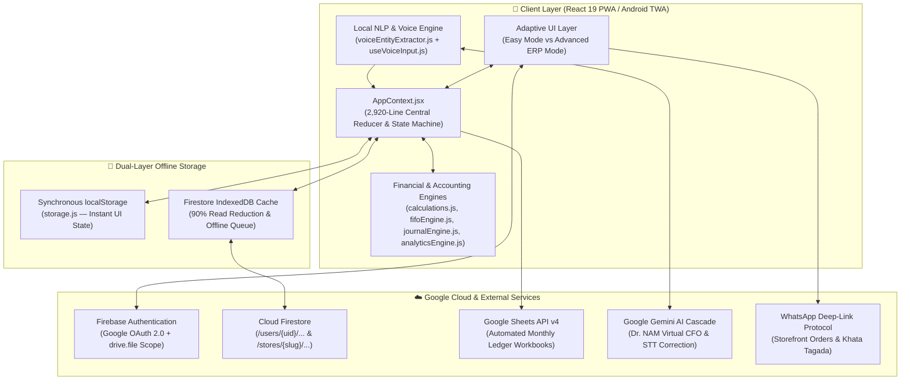

# 🏛️ LEDGERO BY AN3 AI — Complete Technical Architecture, Functional Specification & Codebase Encyclopedia

> **Application Name:** Ledgero (লেজারো — দোকানের ডিজিটাল হিসাবরক্ষক ও ইআরপি)  
> **Organization:** AN3 AI  
> **Live Production Domains:**  
> - `https://ledgero-app.web.app`  
> - `https://ledgero-bd.web.app`  
> - `https://shopbook-app.web.app`  
> - `https://shopbook-460ca.web.app`  
> - `https://shopbook-bd.web.app`  
> **Codebase Scale:** **88 Source Files** | **37,403 Lines of Code** | **2.21 MB Pure Source Code**  
> **Target Market:** Micro-Merchants, Retail Shops, Telecom/MFS Agents (bKash/Nagad), Tea Stalls/Restaurants, F-Commerce Sellers, and SMEs in South Asia (Bangladesh/India) & Global Emerging Markets.  
> **Supported Languages:** Trilingual — Bengali (`bn`), English (`en`), and Hindi (`hi`) with full Banglish (phonetic Bengali in Latin script) NLP comprehension.

---

## 1. EXECUTIVE SUMMARY & PRODUCT VISION

**Ledgero** is a full-stack, offline-first, cloud-synchronized **FinTech POS, Double-Entry ERP, F-Commerce Order Management, Instant E-Commerce Storefront, and AI-Powered Virtual CFO platform**.

Unlike conventional bookkeeping apps (such as Khatabook or Tally) that either oversimplify accounting into a single-entry list or overwhelm small shopkeepers with complex accounting jargon, Ledgero pioneers a **Dual-Mode Adaptive Architecture**:

1. **🟢 Easy Mode (সহজ মোড — Micro-Merchant POS):**  
   A zero-jargon, touch-first interface tailored for daily shopkeepers. Shopkeepers simply record cash in, cash out, product sales, credit (বাকি), and mobile banking transactions. Behind the scenes, Ledgero automatically executes FIFO inventory costing, wallet reconciliation, and double-entry ledger postings.
2. **🟣 Advanced ERP Mode (অ্যাডভান্সড মোড — IFRS Accounting & CFO Suite):**  
   A full institutional-grade financial suite exposing the **Mega-Navbar**, **Manual Double-Entry Journal**, **Trial Balance**, **Income Statement (P&L)**, **Balance Sheet**, **IAS 7 Cash Flow Statement**, **Fixed Asset Depreciation**, **Bank Reconciliation**, **Employee Payroll**, **Fiscal Year Close**, **DuPont Financial Health Scorecard**, and **Dr. NAM (PhD-Caliber AI Virtual CFO)**.

---

## 2. COMPLETE TECHNOLOGY STACK & INFRASTRUCTURE

### 2.1 Core Frontend & Build Pipeline
| Layer | Technology | Version | Purpose in Ledgero |
| :--- | :--- | :--- | :--- |
| **UI Framework** | React (Hooks & Concurrent Mode) | `^19.0.0` | Component rendering, reactive state, custom hooks, error boundaries |
| **Build Bundler** | Vite (Rolldown / ESBuild) | `^6.1.0` | Sub-second HMR, production minification, environment variable injection |
| **Styling Engine** | Tailwind CSS v4 | `^4.0.6` | Utility-first responsive layout, dark/light theme tokens, glassmorphism |
| **Iconography** | Lucide React | `^0.475.0` | Consistent vector iconography across all 45+ screens and modals |
| **Date/Time** | Day.js | `^1.11.13` | Timezone-safe date arithmetic, aging receivable calculations, fiscal periods |
| **XSS Sanitization** | DOMPurify | `^3.2.4` | Input sanitization alongside custom spreadsheet formula injection guards |

### 2.2 Cloud, Database & Persistence Architecture
| Layer | Technology | Implementation Details |
| :--- | :--- | :--- |
| **Authentication** | Firebase Auth (`firebase/auth` `^11.4.0`) | 1-click Google OAuth 2.0 Sign-In, Guest Mode fallback, Re-authentication guard prior to account deletion |
| **Primary Cloud DB** | Cloud Firestore (`firebase/firestore`) | Multi-tenant hierarchical NoSQL document store with strict UID isolation (`users/{userId}/businesses/{bizId}/...`) |
| **Offline Persistence** | Firestore IndexedDB + LocalStorage | Dual-layer offline cache: `enableIndexedDbPersistence(db)` + synchronous `localStorage` state snapshots (`storage.js`) |
| **Automated Spreadsheet Backup** | Google Sheets API v4 (`drive.file` scope) | Non-intrusive OAuth scope (`https://www.googleapis.com/auth/drive.file`) that creates formatted monthly workbooks directly in the merchant's Google Drive |
| **CDN & Hosting** | Firebase Multi-Target Hosting | 5 global CDN endpoints with strict HTTP security headers (CSP, HSTS, X-Frame-Options, nosniff) |

### 2.3 Artificial Intelligence, NLP & Voice Stack
| Layer | Technology | Implementation Details |
| :--- | :--- | :--- |
| **Cloud LLM Engine** | Google Gemini API (3-Tier Cascade) | Cascades across `gemini-3.6-flash` (4s timeout) $\rightarrow$ `gemini-flash-lite-latest` (6s) $\rightarrow$ `gemini-3.5-flash-lite` (6s) with round-robin multi-key failover |
| **Voice Transcript Correction** | Gemini 2.0 Flash-Lite STT Corrector | Post-processes raw Web Speech API output using the shop's live inventory & customer names as domain vocabulary context |
| **Local Offline NLP Engine** | Custom Regex & Phonetic Parser (`voiceEntityExtractor.js`) | Zero-latency (<5ms) offline intent classification & entity extraction supporting Bengali script, Banglish, Hindi, and English |
| **Speech Recognition (STT)** | Browser Web Speech API (`useVoiceInput.js`) | Continuous & push-to-talk voice recognition (`bn-BD`, `en-US`, `hi-IN`) with silence detection and auto-restart |
| **Speech Synthesis (TTS)** | Multi-Engine Trilingual TTS (`naturalVoiceService.js`, `edgeTtsService.js`) | Cascades across ResponsiveVoice, Google Translate TTS stream, and native `window.speechSynthesis` with chunked watchdog timers |

### 2.4 Document & Report Generation
| Layer | Technology | Implementation Details |
| :--- | :--- | :--- |
| **PDF Engine** | `jspdf` (`^2.5.2`) + `jspdf-autotable` (`^3.8.4`) | Generates vector tables for daily Z-Reports, monthly P&L statements, and customer ledgers |
| **Canvas Snapshot** | `html2canvas` (`^1.4.1`) | Renders full-fidelity Bengali/Unicode invoices and receipts into downloadable PNG/PDF documents |

---

## 3. SYSTEM ARCHITECTURE & DATA FLOW DIAGRAM

---

## 4. EXHAUSTIVE FEATURE & CAPABILITY BREAKDOWN

### 4.1 Daily Accounting Lifecycle State Machine
Every business day in Ledgero follows a strict 3-stage accounting state machine (`DAY_STATUS`):
1. **`NOT_STARTED` (দিন শুরু হয়নি — `OpeningScreen.jsx`):**
   - Carries forward previous day's closing wallet balances (`hand_cash`, `bkash`, `nagad`, `rocket`, `upay`, bank accounts) and closing inventory stock.
   - Allows **Opening Balance Adjustments** (`OpeningAdjustmentModal.jsx`) with mandatory audit logging if physical cash differs from previous night's close.
   - Supports dynamic wallet creation (`AddWalletModal.jsx`) and business category switching (`BusinessCategoryModal.jsx`).
2. **`OPEN` (দিন চলমান — `DashboardScreen.jsx`):**
   - unlocks real-time POS sales, inventory purchases, expenses, owner drawings/capital injections, fund transfers, telecom recharges, and Khata credit entries.
   - Features an automated **Auto-Open / Auto-Close Scheduler** (`AppContext.jsx`) with random 0–5 minute jitter to prevent cloud API thundering herds at midnight.
3. **`CLOSED` (দিন শেষ — `ClosingScreen.jsx`):**
   - Guides the merchant through physical cash denomination counting (`CashDifferenceModal.jsx` — ৳1000, ৳500, ৳200, ৳100, ৳50, ৳20, ৳10, ৳5, ৳2, ৳1 notes/coins).
   - Automatically calculates **Cash Shortage / Overage** (`cashDifference`) and posts reconciling entries.
   - Generates a comprehensive **Daily Financial Z-Report** (`ClosingFinancialDetailModal.jsx`), exports to PDF, and automatically syncs the day's ledger to a dedicated tab in the user's monthly **Google Sheet**.

### 4.2 Industry-Specific Specialized Modules
- **Telecom & Mobile Financial Services (MFS) Engine:**
  - Dedicated workflows for **bKash, Nagad, Rocket, Upay** Cash-In, Cash-Out, B2B Agent Transfers, and Flexiload/Recharge slots (`telecom_recharge_slots`).
  - Automatic commission calculation (e.g., 0.41% MFS agent commission or custom rate) separating principal wallet movement from commission revenue.
- **Tea Stall & Restaurant Engine (`TeaHouseScreen.jsx`):**
  - High-speed single-tap counter tally for high-frequency items (দুধ চা, রং চা, বিস্কুট, সিঙ্গারা, সমুচা, কেক, পান/সিগারেট).
  - Separate tracking for **Personal Consumption vs. Shop Expense** (`teaHouseDayPersonal`, `teaHouseDayShop`) and monthly tea tab settlements.

### 4.3 Inventory & FIFO Batch Costing Engine (`fifoEngine.js`)
- Tracks every inventory item with batch-level granularity: `{ batchId, qty, buyPrice, date }`.
- **Purchase Integration (`ADD_INVENTORY_ITEM` & `PurchaseStockModal.jsx`):** Adding a new product or restocking automatically deducts `quantity × buyPrice` from the selected payment wallet and records a `stock_purchase` transaction.
- **FIFO COGS Calculation (`consumeFifoBatches`):** When units are sold, costs are deducted from the oldest batch first, ensuring 100% accurate Gross Profit even when supplier prices fluctuate daily.
- **Stock Audits & Write-Offs:** `StockAuditModal.jsx` reconciles physical vs. system stock; `DamageWriteOffModal.jsx` records expired/damaged goods as operating losses under IAS 2.

### 4.4 Khata (Accounts Receivable & Payable Ledger — `KhataScreen.jsx`)
- Manages Customers (`customer`), Suppliers (`supplier`), Staff (`staff`), and Lenders (`lender`).
- Tracks real-time running balances, transaction history (`ContactLedgerModal.jsx`), and credit limits.
- **Automated WhatsApp Tagada (`GroupTagadaModal.jsx`):** Generates polite, personalized Bengali/English payment reminder messages with exact due amounts and 1-click WhatsApp deep links (`wa.me`).
- **Professional Invoicing (`InvoiceModal.jsx`):** Printable/downloadable itemized invoices with shop branding, previous due, current bill, payment received, and net balance due.

### 4.5 F-Commerce & Courier COD Lifecycle (`OnlineOrdersScreen.jsx` & `courierRates.js`)
Built specifically for Bangladesh's F-Commerce (Facebook/WhatsApp commerce) ecosystem with **strict IFRS 15 Revenue Recognition**:
- **8-State Order Lifecycle:**
  1. `draft` (খসড়া) $\rightarrow$ Order created, no financial/stock impact.
  2. `confirmed` (কনফার্মড) $\rightarrow$ Advance delivery charge collected into selected wallet (`online_order_advance`).
  3. `packed` (প্যাকড) $\rightarrow$ Inventory stock reserved/deducted from `closingStock`.
  4. `shipped` (শিপড) $\rightarrow$ Assigned to courier with tracking number and deep-link tracking URL.
  5. `delivered` (ডেলিভারড) $\rightarrow$ **IFRS 15 Revenue Recognized!** Creates `stock_sale` transaction; COD amount becomes Accounts Receivable from courier (`_courier_ar`).
  6. `settled` (সেটেলড) $\rightarrow$ Courier remits payout; net cash added to merchant's wallet, and delivery charge + COD fee automatically recorded as `courier_expense`.
  7. `returned` (রিটার্নড / RTO) $\rightarrow$ Restores inventory stock, records return delivery charge as `rto_loss` expense, refunds customer advance if applicable, and increments customer's **RTO Fraud Blacklist** counter (`customerBlacklist[phone]`).
  8. `cancelled` (বাতিল) $\rightarrow$ Restores packed stock and reverses advance payment.
- **Built-in Bangladesh Courier Rate Matrix (`courierRates.js`):** Pre-configured rates, COD fees (1%), settlement cycles, and tracking URLs for **Steadfast, Pathao Parcel, RedX, Paperfly, Sundarban Courier, eCourier, and Custom Delivery**.

### 4.6 Instant 1-Click Public Storefront (`PublicStorefront.jsx` & `GoOnlineSetup.jsx`)
- Any shopkeeper can click **"অনলাইন দোকান" (Go Online)** to publish a public e-commerce website at `https://ledgero-app.web.app/s/{shopSlug}`.
- **Security Privacy Filter:** Only `name`, `sellPrice`, and `inStock` status are published to `/stores/{shopSlug}/products`—private `buyPrice` and profit margins are never exposed publicly.
- **Dual Sync Modes:**
  - **Auto-Sync Mode:** A debounced `useEffect` in `App.jsx` watches `state.dayData.inventory` and automatically syncs stock/price updates to Firestore within 2 seconds.
  - **Manual Selection Mode:** Shopkeeper cherry-picks which products to display online.
- **Apple-Inspired Customer Storefront:** Features a clean glassmorphic UI, instant product search, interactive cart drawer, and 1-click **Order via WhatsApp** checkout.

### 4.7 Double-Entry ERP, Financial Statements & CFO Analytics
- **Automated & Manual Journal Engine (`journalEngine.js`, `ManualJournalModal.jsx`):** Maps every POS action into balanced Debit/Credit journal entries across a 5-category Chart of Accounts (`ASSET`, `LIABILITY`, `EQUITY`, `REVENUE`, `EXPENSE`).
- **Financial Reports (`ReportsScreen.jsx`):**
  - **Income Statement (লাভ-ক্ষতি বিবরণী):** Revenue, COGS, Gross Profit, Operating Expenses (broken down by category), Bad Debt/Damage losses, and Net Profit.
  - **Balance Sheet (উদ্বৃত্তপত্র):** Assets (Cash, Wallets, Inventory at cost, Accounts Receivable, Net Fixed Assets) = Liabilities (Accounts Payable, Loans) + Owner's Equity (Opening Capital + Retained Earnings + Net Profit - Owner Drawings).
  - **Cash Flow Statement (নগদ প্রবাহ বিবরণী — IAS 7):** Operating, Investing, and Financing cash flows.
- **14-KPI Business Health Scorecard (`analyticsEngine.js`, `BusinessHealthScorecard.jsx`):**
  - Calculates **DuPont 3-Point ROE** (Net Profit Margin × Asset Turnover × Financial Leverage).
  - **Working Capital Cycle:** $CCC = DSO \text{ (Days Sales Outstanding)} + DSI \text{ (Days Sales of Inventory)} - DPO \text{ (Days Payable Outstanding)}$.
  - **CVP Break-Even Engine:** Contribution Margin Ratio, Daily/Monthly Break-Even Sales Volume, and Margin of Safety %.
  - **Liquidity Ratios:** Current Ratio, Quick (Acid-Test) Ratio, Cash Ratio, and Daily Operating Cash Burn Runway.

### 4.8 Dr. NAM — PhD-Caliber AI Virtual CFO & Voice Assistant (`aiAgentService.js`)
- **Persona & Capabilities:** Acts as an embedded Chartered Accountant (FCA/CPA) and Financial Economist fluent in **Bengali, Hindi, and English**, with built-in knowledge of **Bangladesh NBR VAT Act 2012** (Mushak 6.3, 4% turnover tax vs 15% VAT) and **Income Tax Act 2023**.
- **Voice-to-Transaction Execution:** A shopkeeper can tap the microphone and say in Bengali/Banglish: *"রহিমের কাছে ৫০০ টাকার চা বিক্রি করলাম নগদে"* or *"করিমকে ৩০০ টাকা বাকি দিলাম"*. The pipeline:
  1. Captures speech via `useVoiceInput.js`.
  2. Corrects homophones/transcription errors via Gemini 2.0 Flash-Lite (`correctVoiceTranscript`) using the shop's live inventory/contact names.
  3. Extracts structured intent and entities (`voiceEntityExtractor.js` + `voiceFollowUp.js` for multi-turn slot filling if amount or wallet is missing).
  4. Dispatches the transaction directly to `AppContext` and speaks back a natural human confirmation (`humanResponseGenerator.js` + `naturalVoiceService.js`).

---

## 5. FILE-BY-FILE CODEBASE ENCYCLOPEDIA (ALL 88 FILES)

### 5.1 Root & Public Assets (`public/` & Root Configs)

| File Path | Lines | Size | Detailed Engineering Description |
| :--- | :---: | :---: | :--- |
| `package.json` | 31 | 672 B | Project manifest defining React 19, Vite 6, Tailwind v4, Firebase 11.4, jsPDF, html2canvas, DOMPurify, Day.js, and Lucide icons. |
| `firebase.json` | 357 | 8.9 KB | Multi-site Firebase Hosting configuration for 5 targets (`ledgero-app`, `ledgero-bd`, `app`, `main`, `bd`). Enforces strict security headers (`Content-Security-Policy`, `Strict-Transport-Security`, `X-Frame-Options: DENY`, `X-Content-Type-Options: nosniff`, `Referrer-Policy`, `Permissions-Policy`) and URL rewrites for `/delete-account`, `/privacy-policy`, and SPA routing. |
| `firestore.rules` | 81 | 2.4 KB | Production-hardened Firestore Security Rules. Enforces `isOwner(userId)` on `/users/{userId}/**` with key count bounds ($\le 100$), and validates string lengths, ownership immutability, and positive numeric bounds ($0 \le \text{price} \le 10^8$) on `/stores/{shopSlug}` and `/products/{productId}`. |
| `.env.example` | 22 | 1.2 KB | Template documenting required environment variables (`VITE_FIREBASE_*`, `VITE_GEMINI_API_KEY`, `VITE_GEMINI_API_KEYS`). |
| `public/manifest.json` | 21 | 649 B | PWA Web App Manifest enabling standalone home-screen installation, portrait orientation, and `#0f172a` theme colors. |
| `public/delete-account.html` | 46 | 3.2 KB | Mandatory Google Play Store (2024–2026 policy) external bilingual (Bengali/English) Account & Data Deletion portal accessible without app installation. |
| `public/privacy-policy.html` | 32 | 2.2 KB | Google Play Store compliant FinTech Privacy Policy detailing Google OAuth, AES-256 Firestore encryption, offline IndexedDB caching, and zero ad-tracking. |
| `public/ledgero-sheets-script.js` | 265 | 11.1 KB | Standalone Google Apps Script template (`doPost`/`doGet`) allowing users to optionally deploy a custom Apps Script webhook for Google Sheets syncing. |
| `public/favicon.svg` | 26 | 1.1 KB | Vector brand icon for Ledgero. |

---

### 5.2 Application Entry & Core State Management (`src/` & `src/context/`)

| File Path | Lines | Size | Detailed Engineering Description |
| :--- | :---: | :---: | :--- |
| `src/main.jsx` | 18 | 535 B | React 19 root mount (`createRoot`), wrapping the application in `<StrictMode>` and `<ErrorBoundary>`. |
| `src/index.css` | 443 | 16.3 KB | Global stylesheet, Tailwind v4 imports, custom scrollbar styling, print media queries (`@media print`) for clean receipt/invoice printing, and keyframe animations. |
| `src/App.jsx` | 1,643 | 92.5 KB | Master application shell. Intercepts `/s/:shopSlug` URLs prior to authentication to render `<PublicStorefront />` for customers. Manages top/bottom navigation bars, Easy vs. Advanced mode switching, background Auto-Sync `useEffect` for online stores, keyboard shortcuts (`Alt+S`, `Alt+E`, `Alt+K`, `Alt+A`), PIN lock guard, and modal orchestration. |
| `src/context/AppContext.jsx` | 2,920 | 136.0 KB | **The Heart of Ledgero.** Contains `initialState`, `createNewDayData()`, and a 75+ action `appReducer` managing the entire ERP lifecycle: `OPEN_DAY`, `FINALIZE_DAY`, `START_NEXT_DAY`, `ADD_TRANSACTION`, `DELETE_TRANSACTION`, `ADD_INVENTORY_ITEM` (with automatic wallet deduction & `stock_purchase` logging), `SELL_STOCK` (with FIFO batch consumption), `ADD_CONTACT_TX`, `ONLINE_ORDER_CREATE` / `CONFIRM` / `PACK` / `SHIP` / `DELIVER` / `SETTLE` / `RETURN` / `CANCEL`, `ADD_MANUAL_JOURNAL`, `ADD_FIXED_ASSET`, `RUN_PAYROLL`, `CLOSE_FISCAL_YEAR`, plus cloud sync hooks and auto-open/auto-close timers. |

---

### 5.3 Financial, Accounting & Data Engines (`src/data/`)

| File Path | Lines | Size | Detailed Engineering Description |
| :--- | :---: | :---: | :--- |
| `src/data/calculations.js` | 366 | 13.5 KB | Core mathematical & accounting engine. Exports `roundBDT` (eliminates IEEE-754 floating-point drift), `formatBDT` (formats numbers in `en-IN` lakh/crore grouping with `৳`), `aggregateTransactions` (computes cash inflows, outflows, COGS, service income, commission, and net profit), and `calculateExpectedClosing` per wallet. |
| `src/data/fifoEngine.js` | 92 | 3.7 KB | IAS 2 compliant First-In-First-Out inventory valuation engine. Exports `consumeFifoBatches(batches, qtyNeeded, fallbackBuyPrice)` which iterates chronologically through purchase layers, deducts quantities, and returns exact `totalCogs` and `weightedAvgBuyPrice`. |
| `src/data/journalEngine.js` | 381 | 15.6 KB | Double-Entry Bookkeeping Engine. Defines the standard `CHART_OF_ACCOUNTS` (Assets `1000–1500`, Liabilities `2000–2200`, Equity `3000–3200`, Revenue `4000–4300`, Expenses `5000–5900`), automatically translates single-entry POS transactions into balanced Debit/Credit journal entries, and generates the Trial Balance and General Ledger. |
| `src/data/analyticsEngine.js` | 786 | 41.1 KB | PhD-grade corporate finance & econometric engine. Computes the 100-point `calculateBusinessHealthScorecard` (Liquidity, Profitability, Efficiency, Solvency), `calculateProjectedCashFlow` (30-day Monte Carlo / trend projection), DuPont ROE decomposition, $CCC = DSO + DSI - DPO$, CVP Break-even metrics, dead-stock identification, and debtor concentration risk. |
| `src/data/constants.js` | 451 | 29.9 KB | Central registry of enums and templates: `SCREENS`, `DAY_STATUS`, `TX_TYPES`, `EXPENSE_CATEGORIES`, `BUSINESS_CATEGORIES` (Telecom, Tea Stall, Grocery, Pharmacy, Clothing, Electronics, Hardware, General), default wallet generators (`createDefaultWallets`, `createGeneralWallets`), and default product catalogs. |
| `src/data/courierRates.js` | 252 | 10.1 KB | F-Commerce logistics engine. Contains real-world delivery tariff matrices, COD percentages, return charges, and tracking URL generators for Steadfast, Pathao, RedX, Paperfly, Sundarban, and eCourier. Defines the state transition graph (`VALID_TRANSITIONS`), `calculateCourierCharges()`, and `generateWhatsAppMessage()`. |
| `src/data/storage.js` | 464 | 16.2 KB | LocalStorage persistence & multi-business isolation manager. Prefixes keys by `bizId` (`shop_{bizId}_day_{date}`, `shop_catalog_{bizId}`, `shop_{bizId}_contacts`), handles corrupt JSON recovery, exports/imports full JSON backups, and executes complete business data wipe (`deleteBusinessLocalData`). |
| `src/data/taxConfig.js` | 140 | 5.4 KB | Bangladesh NBR regulatory engine. Models VAT Act 2012 (Standard 15% VAT, 4% Enlisted Turnover Tax, 5% Retail Trade VAT, Mushak 6.3 invoice rules) and Income Tax Act 2023 slabs for SME tax estimation. |
| `src/data/themeTokens.js` | 93 | 3.7 KB | Semantic color and typography design tokens ensuring consistent contrast ratios across Light Mode and Dark Mode. |
| `src/data/translations.js` | 530 | 58.1 KB | Comprehensive localization dictionary (`t(key, lang)`) containing 600+ UI strings in Bengali (`bn`), English (`en`), and Hindi (`hi`). |

---

### 5.4 Firebase, Cloud Sync, Security & Google Sheets (`src/firebase/`)

| File Path | Lines | Size | Detailed Engineering Description |
| :--- | :---: | :---: | :--- |
| `src/firebase/firebaseConfig.js` | 63 | 3.2 KB | Initializes Firebase App, Auth, and Firestore. Enforces startup validation on `VITE_FIREBASE_*` environment variables (refuses to start if critical vars are missing), configures `sheetsProvider` with `drive.file` scope, and activates `enableIndexedDbPersistence(db)`. |
| `src/firebase/useAuth.jsx` | 182 | 5.7 KB | React Auth Context & Provider. Manages `signInWithGoogle`, `loginAsGuest`, `signOutUser`, `connectGoogleSheets` (stores token in `sessionStorage`), `reauthWithGoogle`, and `deleteAccount` (re-authenticates user, wipes Firestore & local storage, and deletes Firebase Auth user record). |
| `src/firebase/firestoreService.js` | 321 | 13.0 KB | Cloud CRUD service. Manages hierarchical reads/writes for `saveProfile`, `saveSettings`, `saveBusinesses`, `saveDayToCloud`, `loadDayFromCloud`, `loadMonthDaysFromCloud`, `saveContactsToCloud`, `saveContactTxsToCloud`, full JSON data export, and recursive `deleteAllUserData(userId, businesses)` for GDPR/Play Store compliance. |
| `src/firebase/sheetsService.js` | 385 | 17.6 KB | Automated Google Sheets ERP Exporter. Creates a formatted monthly spreadsheet per business (`Ledgero - {ShopName} - {Month} {Year}`), builds an executive summary index tab, formats headers/borders/colors via Sheets `batchUpdate`, and sanitizes every cell via `sanitizeSpreadsheetCell()` to prevent CSV/Formula Injection. |
| `src/firebase/auditService.js` | 86 | 2.9 KB | Immutable financial audit logger. Records sensitive actions (opening balance edits, deleted transactions, stock write-offs, PIN changes) with timestamp, actor role, before/after values, and reason to Firestore `auditLog`. |

---

### 5.5 AI Virtual CFO, NLP & Trilingual Voice Services (`src/services/` & `src/hooks/`)

| File Path | Lines | Size | Detailed Engineering Description |
| :--- | :---: | :---: | :--- |
| `src/services/aiAgentService.js` | 3,127 | 345.7 KB | **Master AI Brain (Dr. NAM).** Manages the multi-key rotation pool (`getKeyPool`, `rotateToNextKey`), Gemini 2.0 Flash-Lite voice transcript corrector (`correctVoiceTranscript`), local deterministic financial query solver (`processLocalAIQuery` — answers 50+ intents offline), and the 3-tier Gemini LLM cascade (`askGeminiAI`) with full live injection of liquidity, profitability, DuPont, inventory, and debtor datasets. |
| `src/services/voiceEntityExtractor.js` | 583 | 32.1 KB | Local Natural Language Understanding (NLU) parser. Converts Bengali numerals (`০-৯`) and spoken number words (*"পাঁচশ"*, *"দেড় হাজার"*, *"pachsho"*) into integers, fuzzy-matches spoken product and customer names against the shop's catalog/Khata, and classifies 18+ transaction intents (`sale`, `stock_sell`, `restock`, `expense`, `due_give`, `due_collect`, `transfer`, `recharge`, `owner_draw`, etc.). |
| `src/services/voiceFollowUp.js` | 233 | 11.0 KB | Conversational slot-filling state machine. When a user gives an incomplete voice command (e.g., *"বাকি দিলাম ৫০০ টাকা"* without specifying the customer name), it holds the partial transaction in memory and prompts the user solely for the missing slot. |
| `src/services/humanResponseGenerator.js` | 580 | 29.5 KB | Generates warm, context-aware, non-repetitive trilingual (`bn`/`en`/`hi`) spoken and written responses for local actions, complete with financial insights and encouragement. |
| `src/services/naturalVoiceService.js` | 358 | 15.8 KB | High-fidelity trilingual Text-to-Speech (TTS) orchestrator. Strips markdown/emojis while preserving prosody punctuation (`।`, `?`, `,`), splits long responses into phonetic chunks, and cascades across ResponsiveVoice, Google TTS audio streams, and native speech synthesis with watchdog timers. |
| `src/services/edgeTtsService.js` | 199 | 5.9 KB | Secondary neural voice synthesis fallback supporting Bengali (`bn-BD-NabanitaNeural`), Hindi (`hi-IN-SwaraNeural`), and English voices. |
| `src/hooks/useVoiceInput.js` | 307 | 12.1 KB | Custom React hook wrapping `webkitSpeechRecognition` / `SpeechRecognition`. Handles microphone permissions, interim vs. final transcripts, continuous listening mode, echo suppression while Dr. NAM is speaking, and mobile browser quirks. |

---

### 5.6 UI Components — Screens & Feature Modules (`src/components/`)

#### A. AI Assistant UI (`src/components/AIAgent/`)
| File Path | Lines | Size | Detailed Engineering Description |
| :--- | :---: | :---: | :--- |
| `AIAgentDrawer.jsx` | 1,438 | 79.2 KB | Full-featured slide-out & floating AI interface for Dr. NAM. Includes real-time voice waveform visualizer, continuous hands-free conversation mode, 1-click transaction confirmation cards, language switcher (`bn`/`hi`/`en`), and custom API key settings. |
| `AIAgentFloatingButton.jsx` | 33 | 2.0 KB | Persistent floating action button with pulsing voice-active ring to summon Dr. NAM from any screen. |

#### B. Advanced ERP Navigation & Analytics (`src/components/AdvancedNav/` & `Analytics/`)
| File Path | Lines | Size | Detailed Engineering Description |
| :--- | :---: | :---: | :--- |
| `AdvancedMegaNavbar.jsx` | 396 | 21.8 KB | Institutional ERP command bar organizing tools into 5 pillars: Accounting & Journal, Inventory & Assets, Treasury & Banking, CFO Analytics, and Online Store/Orders. |
| `GlobalQuickActionModal.jsx` | 232 | 16.4 KB | Command-palette style modal (`Ctrl+K`) for rapid transaction entry from anywhere in Advanced Mode. |
| `AnalyticsHub.jsx` | 181 | 8.8 KB | Container screen hosting the 4 CFO analytical modules below. |
| `BusinessHealthScorecard.jsx` | 382 | 23.8 KB | Visualizes the 0–100 Business Health Score, DuPont ROE pyramid, Liquidity gauges, and Working Capital Cycle ($CCC$) metrics. |
| `CashFlowManager.jsx` | 364 | 19.4 KB | 30-day cash flow forecaster, daily burn rate analyzer, and upcoming payable/recurring expense alert dashboard. |
| `OperationsPipeline.jsx` | 257 | 13.8 KB | Inventory turnover velocity, fast-moving vs. dead-stock matrix, and reorder point recommendations. |
| `VirtualCFOCommentary.jsx` | 176 | 10.0 KB | Automated executive board memo generator summarizing strengths, financial risks, and 3-step action plans. |

#### C. Core Daily Operations (`src/components/Opening/`, `Dashboard/`, `Closing/`, `Auth/`)
| File Path | Lines | Size | Detailed Engineering Description |
| :--- | :---: | :---: | :--- |
| `LoginScreen.jsx` | 149 | 9.0 KB | Bilingual landing & authentication screen with 1-click Google Sign-In, Guest Mode trial button, and security feature highlights. |
| `OpeningScreen.jsx` | 837 | 46.0 KB | Morning setup wizard. Displays carried-forward wallet balances, allows adding/deleting wallets, manages initial stock setup, and transitions day to `OPEN`. |
| `DashboardScreen.jsx` | 2,161 | 129.0 KB | Primary operational cockpit. Houses wallet balance cards, quick POS sale bar, Telecom/MFS recharge & cash-in/out grid, inventory table with search & low-stock badges, live transaction feed, and quick-action triggers. |
| `CashBoxReportModal.jsx` | 177 | 10.1 KB | Real-time breakdown of physical cash vs. digital wallet movements during the open day. |
| `ExpenseModal.jsx` | 228 | 10.8 KB | Records operating expenses across 12+ categories (Rent, Electricity, Staff Tea, Transport, Packaging, etc.) from any wallet. |
| `ServiceIncomeModal.jsx` | 109 | 3.8 KB | Records non-inventory service revenue (photocopy, studio photography, mobile repair, commissions). |
| `TransferModal.jsx` | 208 | 8.7 KB | Inter-wallet contra transfers (e.g., Bank to Hand Cash, Hand Cash to bKash Agent) with optional transfer fee deduction. |
| `LoanModal.jsx` | 170 | 8.4 KB | Records borrowing (`loan_taken`) and loan repayments (`loan_repaid`) with lender tracking. |
| `OwnerTransactionModal.jsx` | 215 | 10.6 KB | Separates Owner's Personal Drawings (`personal_draw`) and Capital Injections (`owner_gave`) from business profit (Entity Concept). |
| `RecurringExpenseManager.jsx` | 276 | 13.1 KB | Automates monthly fixed expenses (shop rent, Wi-Fi, salaries) with daily pro-rata accrual tracking and 1-click payment posting. |
| `ClosingScreen.jsx` | 2,019 | 120.4 KB | End-of-day reconciliation suite. Compares expected vs. actual wallet balances, generates the daily P&L summary, builds downloadable PDF Z-Reports, and triggers 1-click or automated Google Sheets cloud backup. |
| `CashDifferenceModal.jsx` | 393 | 25.0 KB | Interactive Bangladeshi currency note & coin denomination calculator (`৳1000` down to `৳1`) to pinpoint exact physical cash shortages or overages. |
| `ClosingFinancialDetailModal.jsx` | 563 | 35.1 KB | Deep-dive audit modal on the Closing Screen showing itemized calculation formulas for every inflow, outflow, and profit metric. |

#### D. Inventory, Khata, Online Orders & Public Storefront (`src/components/Inventory/`, `Khata/`, `OnlineOrders/`, `PublicStore/`)
| File Path | Lines | Size | Detailed Engineering Description |
| :--- | :---: | :---: | :--- |
| `PurchaseStockModal.jsx` | 308 | 16.5 KB | Restocks existing products, creates new FIFO cost batches, and deducts purchase cost from the chosen wallet or records supplier credit. |
| `DamageWriteOffModal.jsx` | 191 | 10.2 KB | Writes off spoiled, broken, or stolen inventory units and records the exact FIFO cost as an abnormal loss. |
| `StockAuditModal.jsx` | 198 | 10.8 KB | Physical stock-taking reconciliation tool that adjusts system quantities to match physical shelf counts. |
| `KhataScreen.jsx` | 505 | 29.4 KB | Master Receivables (পাওনা) & Payables (দেনা) directory with search, filter by role, aging badges, and summary totals. |
| `AddContactModal.jsx` | 283 | 14.2 KB | Creates customer, supplier, staff, or lender profiles with opening due balances and phone validation. |
| `ContactLedgerModal.jsx` | 622 | 36.1 KB | Individual account statement view showing chronological debit/credit history, partial due collection/payment forms, WhatsApp reminder trigger, and statement print. |
| `GroupTagadaModal.jsx` | 304 | 18.2 KB | Batch debt-collection tool allowing the shopkeeper to send customized WhatsApp payment reminders to all overdue debtors sequentially. |
| `InvoiceModal.jsx` | 394 | 22.3 KB | High-resolution bilingual POS receipt and tax invoice generator with PNG/PDF download and thermal/A4 print support. |
| `OnlineOrdersScreen.jsx` | 1,116 | 68.3 KB | Complete F-Commerce Order Management System. Features stats bar, status filter tabs, inline order creation with multi-item cart, automatic courier charge & COD fee calculator, RTO fraud blacklist warning banner, WhatsApp confirmation sender, and 1-click status progression (`Confirm` $\rightarrow$ `Pack` $\rightarrow$ `Ship` $\rightarrow$ `Deliver` $\rightarrow$ `Settle` / `Return`). |
| `GoOnlineSetup.jsx` | 462 | 24.9 KB | Merchant control panel to configure custom store display name, unique URL slug, WhatsApp order number, Auto-Sync toggle, and product selection for the public store. |
| `PublicStorefront.jsx` | 323 | 17.4 KB | Standalone, unauthenticated customer-facing e-commerce web app (`/s/:shopSlug`). Features Apple-inspired UI, real-time Firestore product catalog loading, instant search, floating cart drawer, and formatted WhatsApp order submission. |

#### E. Institutional ERP Modals, Reports & Shared Guards (`src/components/Assets/`, `Banking/`, `Journal/`, `Payroll/`, `PeriodClose/`, `Profile/`, `Reports/`, `TeaHouse/`, `Tutorial/`, `Shared/`)
| File Path | Lines | Size | Detailed Engineering Description |
| :--- | :---: | :---: | :--- |
| `FixedAssetsModal.jsx` | 297 | 17.4 KB | IAS 16 Fixed Asset Register (refrigerators, computers, furniture) with Straight-Line and Reducing-Balance depreciation calculation. |
| `BankReconciliationModal.jsx` | 264 | 14.1 KB | Reconciles Ledgero bank wallet balances against physical bank statements, tracking uncleared checks and bank charges. |
| `ManualJournalModal.jsx` | 284 | 15.8 KB | Double-entry journal voucher creator enforcing $\sum \text{Debits} = \sum \text{Credits}$ before posting to the General Ledger. |
| `PayrollModal.jsx` | 384 | 21.7 KB | Employee salary register managing base pay, overtime, advances/deductions, and net salary disbursement. |
| `FiscalYearCloseModal.jsx` | 208 | 12.9 KB | Year-end closing wizard that zeroes out temporary Revenue/Expense accounts and transfers Net Income to Retained Earnings / Owner's Capital. |
| `ReportsScreen.jsx` | 1,116 | 73.5 KB | Multi-tab financial reporting center: Monthly Summary, Income Statement (P&L), Balance Sheet, Cash Flow Statement, Tax/VAT Estimator, and multi-month historical comparison with PDF/CSV export. |
| `TeaHouseScreen.jsx` | 586 | 29.0 KB | Dedicated rapid-tap counter interface and monthly customer tea-tab manager for tea stalls and cafes. |
| `ProfileModal.jsx` | 586 | 33.9 KB | Account & Business Settings center: manages multiple businesses, staff/owner role switching, PIN setup, JSON backup export/restore, and the GDPR/Google Play compliant **Permanent Account Deletion** flow. |
| `TutorialModal.jsx` | 381 | 33.7 KB | Interactive step-by-step onboarding guide explaining Easy Mode, Advanced Mode, Voice AI, and Closing workflows. |
| `AddProductModal.jsx` | 283 | 14.3 KB | Adds new SKUs to inventory with unit selection, buy/sell price, initial stock, and automatic wallet deduction. |
| `EditProductModal.jsx` | 454 | 25.3 KB | Edits product metadata, adjusts prices, and inspects active FIFO cost batches. |
| `AddWalletModal.jsx` | 205 | 9.8 KB | Creates custom cash, mobile banking, or bank wallets. |
| `EditWalletModal.jsx` | 143 | 6.8 KB | Renames wallets or adjusts wallet category settings. |
| `OpeningAdjustmentModal.jsx` | 248 | 12.8 KB | Modifies opening wallet balances with mandatory reason logging to the immutable audit trail. |
| `AuditLogModal.jsx` | 135 | 7.2 KB | Displays chronological, tamper-evident security & financial audit logs from Firestore. |
| `BusinessCategoryModal.jsx` | 227 | 12.2 KB | Switches business industry preset (Telecom, Tea House, Retail, etc.) and loads appropriate default wallets/workflows. |
| `PinLockModal.jsx` | 207 | 8.6 KB | 4-digit PIN security screen with brute-force protection (locks after failed attempts) to restrict staff from accessing owner settings. |
| `RoleGuard.jsx` | 21 | 823 B | Access-control wrapper (`useIsOwner`) that hides sensitive profit margins and deletion controls when in Staff/Cashier mode. |
| `ModeGuard.jsx` | 34 | 1.7 KB | Context provider (`useAppMode`) managing seamless switching between `easy` and `advanced` UI modes. |
| `CurrencySwitcher.jsx` | 60 | 3.0 KB | Allows display currency symbol customization (`৳`, `₹`, `$`, etc.). |
| `ErrorBoundary.jsx` | 60 | 2.7 KB | React class error boundary that catches render exceptions, offers a 1-click safe recovery reset to Easy Mode, and prevents white-screen crashes. |
| `KeyboardShortcutsModal.jsx` | 71 | 4.1 KB | Displays desktop/POS keyboard shortcuts for rapid navigation. |
| `LedgeroLogo.jsx` | 35 | 1.2 KB | Scalable SVG brand logo component. |
| `Modal.jsx` | 51 | 1.5 KB | Reusable accessible modal wrapper with backdrop blur and Escape-key dismissal. |

---

## 6. ACCOUNTING & FINANCIAL ENGINEERING STANDARDS

Ledgero is engineered to pass scrutiny from professional Chartered Accountants (CA/CPA):

1. **Accounting Entity Concept:** Owner's personal drawings (`personal_draw`) and capital injections (`owner_gave`) are strictly excluded from the Income Statement and tracked directly in the Statement of Owner's Equity.
2. **IAS 2 Inventory & FIFO Costing:** Inventory is valued at historical batch cost. Gross profit is calculated ONLY when goods are sold:
   $$\text{Gross Profit} = \text{Sales Revenue} - \sum_{i} (\text{Qty Sold}_i \times \text{FIFO Batch Cost}_i)$$
   Purchasing stock is treated as an Asset exchange ($\text{Dr Inventory}, \text{Cr Cash/Wallet}$), never as an immediate expense.
3. **IFRS 15 Five-Step Revenue Recognition (Online Orders):**
   - Creating, confirming, packing, or shipping a COD order **does not** recognize revenue.
   - Advance delivery charges received from customers are held as a liability/unearned deposit until fulfillment.
   - Revenue and COGS are recognized **strictly upon `ONLINE_ORDER_DELIVER`** when control transfers to the customer, creating an Accounts Receivable asset against the courier (`_courier_ar`).
   - Upon `ONLINE_ORDER_SETTLE`, the courier receivable is cleared, net cash enters the wallet, and delivery/COD fees are recognized as distribution expenses.
4. **DuPont & Working Capital Econometrics:**
   $$\text{ROE} = \underbrace{\left(\frac{\text{Net Profit}}{\text{Revenue}}\right)}_{\text{Net Margin}} \times \underbrace{\left(\frac{\text{Revenue}}{\text{Total Assets}}\right)}_{\text{Asset Turnover}} \times \underbrace{\left(\frac{\text{Total Assets}}{\text{Owner's Equity}}\right)}_{\text{Equity Multiplier}}$$

---

## 7. SECURITY, PRIVACY & GOOGLE PLAY COMPLIANCE ARCHITECTURE

1. **Zero Hardcoded Secrets:** All API keys and Firebase configurations reside strictly in environment variables (`.env`), validated at boot in `firebaseConfig.js`.
2. **Multi-Tenant Firestore Isolation:** `firestore.rules` enforces `request.auth.uid == userId` on all private subcollections, preventing Insecure Direct Object Reference (IDOR) and cross-tenant data leakage.
3. **Schema & Bounds Validation:** Public storefront rules validate string lengths (`shopSlug` 3–50 chars, `shopName` 1–100 chars) and enforce non-negative product prices ($0 \le \text{price} \le 10^8$).
4. **Spreadsheet Formula Injection Defense:** `sanitizeSpreadsheetCell()` in `sheetsService.js` neutralizes payload strings starting with `=`, `+`, `-`, `@`, `\t`, or `\r` before exporting to Google Sheets.
5. **Enterprise HTTP Security Headers:** All 5 Firebase Hosting targets serve strict `Content-Security-Policy`, `Strict-Transport-Security` (1 year + preload), `X-Frame-Options: DENY`, `X-Content-Type-Options: nosniff`, and `Permissions-Policy`.
6. **Google Play Store 2024–2026 Compliance:**
   - **In-App Account Deletion:** Re-authenticates the user via Google OAuth, recursively deletes all Firestore subcollections (`deleteAllUserData`), deletes the Firebase Auth user, and wipes `localStorage`/`sessionStorage`.
   - **Public Web Deletion & Privacy Endpoints:** Hosted live at `/delete-account` and `/privacy-policy` for external compliance verification.
